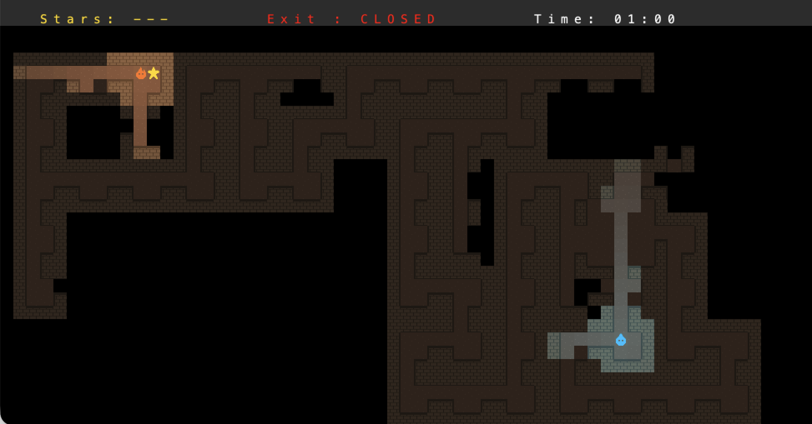

# Aqua & Ignis

> **Note:** this branch has work done after the course submission.
> If you are looking for inspiration for your own LDTS project, take a look at the `main` branch instead.

Aqua & Ignis is a two-player escape game. Aqua and Ignis are lost in a dark maze and have to collect 3 stars and the key, avoid the monsters, and reach the exit together. Each player only sees a small area around them.

Made with Java and [Lanterna](https://github.com/mabe02/lanterna).



## Run

You need JDK 21. Then:

```
./gradlew run
```

Run the tests with `./gradlew test` (some tests open a real window, so they need a display).

## Controls

| | Move |
|---|---|
| Aqua | W A S D |
| Ignis | Arrow keys |

Enter selects a menu entry and `q` quits.

## Graphics

Lanterna draws text, so the sprites are letters in a custom font:

- The 16×16 sprites are drawn as text in `src/main/resources/sprites/sprites.txt` (`#` is the sprite colour, `.` is the background).
- `TileFontBuilder` turns them into the font `src/main/resources/fonts/AquaIgnisTiles.ttf`.
- The game draws one letter of that font per tile.

To change a sprite, edit `sprites.txt` and run:

```
./gradlew buildFont
```
